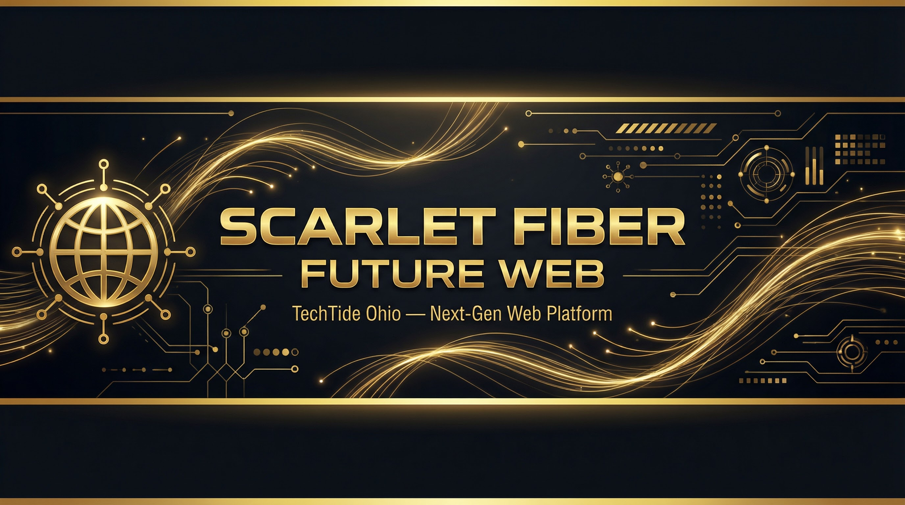

<!-- HEADER BANNER -->
<div align="center">
  
</div>

<div align="center">

[](https://www.typescriptlang.org/)
[](https://react.dev/)
[](https://vitejs.dev/)
[](https://tailwindcss.com/)
[](https://github.com/TechTideOhio)

</div>

> **Scarlet Fiber Future Web is TechTide Ohio's next-generation web platform**: a modern, responsive web application built with React, TypeScript, Vite, and Tailwind CSS. Designed as the digital backbone for TechTide's Ohio operations.

---

## Why this fork exists

**What it does.** Scarlet Fiber Future Web is a responsive React 18, TypeScript, Vite, and Tailwind CSS marketing site with five public routes (`/`, `/services`, `/our-work`, `/about`, `/contact`), an animated fiber hero, a sanitized contact form, and a quality gate (`npm run build`, `lint`, `typecheck`, `test`) that runs in GitHub Actions. Use it to develop and validate the site locally, or as the reference implementation for a TechTide-branded TypeScript, Vite, and Tailwind web presence.

**Who it serves.** TechTide engineers who start a new client marketing site and want a working, type-checked frontend with brand tokens, page components, and CI already wired, and visitors of the TechTide Ohio site itself.

**Why Alex forked it.** The upstream repository, [TechTideOhio/scarlet-fiber-future-web](https://github.com/TechTideOhio/scarlet-fiber-future-web), is the Buckeye DataCom fiber-optic company website generated with Lovable (its README is titled "Buckeye DataCom - Fiber Optic Solutions Website"; most upstream commits are by `gpt-engineer-app[bot]`). This fork was created on 2025-07-01 (GitHub `created_at`) at upstream commit `c07fe47` (2025-06-30) into the personal account of Alex Cinovoj, Founder & CTO of TechTide AI, who is also the public member of the TechTideOhio organization. The fork's own history records what it became rather than a stated reason for the split: the first fork-only commits added documentation and build changes (`43cd195`, 2025-06-30: "Added full docs"; `21827e4`, 2025-06-30: "Update components and build optimizations for BuckeyeDataCom deployment"), the README was rebranded as the TechTide Ohio platform (`f289f30`, 2026-02-18: "Enterprise-grade README with gold-themed branding and full documentation"), quality gates and a CI workflow were added (`e612fdb` and `fef99d3`, 2026-08-17), and two security pull requests landed on 2026-10-18 (#1 `289f443`, #2 `c734134`). The GitHub repository description calls it "the production frontend scaffold TechTide starts every client project from", and the unmerged branch `techtide/build-out` (`71428e3`, 2026-05-21: "docs: add TechTide backstory") says the same. The code in this fork is the marketing site plus quality gates; it does not yet contain the auth flows or API patterns that branch describes.

**Real-world use case (2025–2026 evidence).** **Proposed use case.** A TechTide engineer starts a new client marketing site by cloning this fork, running `npm ci` and the quality gate, replacing the brand tokens in `tailwind.config.ts` and the page components under `src/pages/`, and shipping the static `dist/` output from `npm run build`. The stack this fork pins supports that workflow: Vite 8 (released 2026-03-12) is the build tool[^1], Tailwind CSS v4 (released 2025-01-22) provides the design tokens through `@tailwindcss/postcss`[^2], the contact form is sanitized with DOMPurify 3.4.17 (released 2026-10-12)[^3], and the vendored `braces` patch guards the build against GHSA-vfj7-8cjw-p6xm (published 2026-09-18)[^4]. No client project started from this fork is recorded in the repository, so the scenario is labelled proposed.

[^1]: Vite team, "Announcing Vite 8". https://vite.dev/blog/announcing-vite8 (published 2026-03-12).
[^2]: Tailwind Labs, "Tailwind CSS v4.0". https://tailwindcss.com/blog/tailwindcss-v4 (published 2025-01-22).
[^3]: cure53, DOMPurify release 3.4.17. https://github.com/cure53/DOMPurify/releases/tag/3.4.17 (published 2026-10-12).
[^4]: GitHub Advisory Database, GHSA-vfj7-8cjw-p6xm, "braces vulnerable to stack-exhaustion denial of service through deeply nested patterns". https://github.com/advisories/GHSA-vfj7-8cjw-p6xm (published 2026-09-18).

## Upstream

Upstream is [TechTideOhio/scarlet-fiber-future-web](https://github.com/TechTideOhio/scarlet-fiber-future-web), owned by the TechTideOhio organization (display name "TechTide AI", created 2025-03-04), which is the canonical repository for the deployed Buckeye DataCom site. Neither upstream nor this fork publishes a license; see Licensing below. This fork was created 2025-07-01 from `c07fe47`.

**What changed in this fork.** `git log upstream/main..origin/main` on 2026-10-21 lists 10 fork-only commits; `git diff --stat upstream/main origin/main` shows 199 files changed (8,938 insertions, 11,455 deletions):

- 2025-06-30 to 2025-07-01: full documentation set under `docs/`, build optimizations, and button updates (4 commits).
- 2026-02-18: TechTide Ohio README rebrand and `assets/banner.png` (`f289f30`).
- 2026-08-17: `CODE_OF_CONDUCT.md`, `CONTRIBUTING.md`, `SECURITY.md`, `SUPPORT.md`, `tests/`, `typecheck` and `test` scripts, and `.github/workflows/quality.yml` (3 commits).
- 2026-10-18: dependency refresh with the vendored `braces` guard (#1) and the DOMPurify-based sanitizer (#2).

**Behind upstream.** 167 commits as of 2026-10-21 (`gh api repos/Alexi5000/scarlet-fiber-future-web/compare/TechTideOhio:main...Alexi5000:main`: ahead 10, behind 167, diverged). Upstream kept evolving the Buckeye DataCom site through 2026-10-19, including its own security pull requests #1 to #3; none of that work is merged here.

## Key Features

| Feature | Description |
|---------|-------------|
| **Modern Stack** | React 18 + TypeScript + Vite for blazing-fast development and builds |
| **Responsive Design** | Tailwind CSS with mobile-first responsive layouts |
| **Component Architecture** | Modular, reusable React components with clean separation of concerns |
| **Performance Optimized** | Vite's HMR for instant dev feedback, optimized production bundles |
| **Type Safe** | Full TypeScript coverage for reliability and developer experience |
| **Accessible** | Built with accessibility best practices and semantic HTML |

## Verified install and use quickstart

Use Node.js 22.12 or newer and npm. The commands below install the locked dependency graph, validate the application contract, and start the local Vite server.

```bash
git clone https://github.com/Alexi5000/scarlet-fiber-future-web.git
cd scarlet-fiber-future-web

npm ci
npm run build
npm run lint
npm run typecheck
npm run test
npm run dev
```

Open `http://localhost:5173` to use the application locally. For a production-like local check after building, run `npm run preview` and open the URL printed by Vite.

The focused smoke suite verifies the public route map, landing-page composition, README quickstart, and support-documentation paths. Browser-level end-to-end flows remain a suitable follow-up when the deployment environment and analytics/contact integrations are available.

## Project Structure

```
src/
├── components/     # Reusable UI components (shadcn/ui primitives under components/ui)
├── config/         # Application configuration (security settings)
├── hooks/          # Custom React hooks (animation, performance, device)
├── lib/            # Shared helpers
├── pages/          # Route components: Index, Services, OurWork, About, Contact, NotFound
├── styles/         # Additional stylesheets
├── utils/          # Device detection, fiber geometry, security helpers
├── App.tsx         # Root application component and route map
├── App.css         # Global styles
├── index.css       # Tailwind entry
└── main.tsx        # Application entry point
```

## Technology Stack

| Category | Technology |
|----------|-----------|
| **Framework** | React 18 |
| **Language** | TypeScript |
| **Build Tool** | Vite |
| **Styling** | Tailwind CSS |
| **Organization** | TechTide Ohio |
| **Deployment** | Not configured in this fork; upstream deploys through Lovable |

## Security

Open Dependabot alerts: 0 as of 2026-10-21. The `braces` advisory [GHSA-vfj7-8cjw-p6xm](https://github.com/advisories/GHSA-vfj7-8cjw-p6xm) (published 2026-09-18) is a known upstream advisory with no fixed release as of 2026-10-20; this fork mitigates it with a vendored patched tarball (`vendor/braces-3.0.3.tgz`, pinned through `package.json` overrides) and `scripts/verify-braces.cjs`, which checks file hashes and recursion limits before every `npm run build` (added in #1, `289f443`, 2026-10-18). User-supplied markup is sanitized with DOMPurify (#2, `c734134`, 2026-10-18; covered by `tests/security.test.mjs`). Report vulnerabilities as described in [SECURITY.md](./SECURITY.md).

## Support and contact

For a website correction, project inquiry, or collaboration request, open a focused GitHub issue or contact [TechTide AI](https://techtideai.io). Include the page or route involved, the expected visitor outcome, and screenshots or browser details where useful. Do not post credentials, private customer information, or security-sensitive material in public issues. For contribution and security guidance, see [CONTRIBUTING.md](./CONTRIBUTING.md), [SUPPORT.md](./SUPPORT.md), and [SECURITY.md](./SECURITY.md).

## Contributing

Contributions are welcome. Please read [CONTRIBUTING.md](./CONTRIBUTING.md) and open an issue to discuss meaningful changes before submitting a pull request.

## Licensing

No project-wide license has been published in this repository. Do not assume permission to redistribute the code, visual assets, or brand materials beyond the terms made available by the maintainers.

---

<div align="center">

**Maintained by [Alex Cinovoj](https://alexcinovoj.dev), Founder & CTO of [TechTide AI](https://techtideai.io)**

*A [TechTide Ohio](https://github.com/TechTideOhio) project*

</div>
